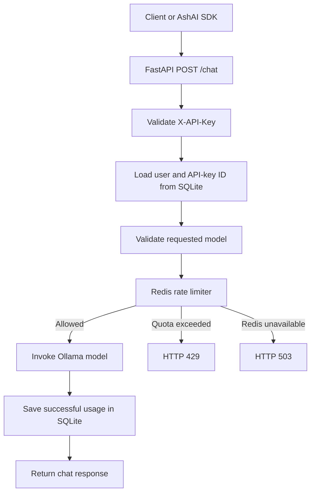

# AshAI Server

AshAI Server is a FastAPI-based backend that exposes locally hosted large language models through a REST API. It provides account authentication, API-key management, model selection, chat inference, usage logging, and per-API-key daily rate limiting.

The project uses Ollama for model inference, SQLite with SQLAlchemy for persistent application data, and Redis for fast request counters. A separate Python SDK can consume the server's HTTP API.

## Contents

- [Overview](#overview)
- [Features](#features)
- [Architecture](#architecture)
- [Technology stack](#technology-stack)
- [Project structure](#project-structure)
- [Prerequisites](#prerequisites)
- [Installation and setup](#installation-and-setup)
- [Running the application](#running-the-application)
- [API reference](#api-reference)
- [Redis rate limiter: how it works](#redis-rate-limiter-how-it-works)
- [Testing](#testing)
- [Configuration](#configuration)
- [Security and operational notes](#security-and-operational-notes)
- [Known limitations and future improvements](#known-limitations-and-future-improvements)

## Overview

AshAI Server acts as the backend between client applications and locally hosted language models.

A client authenticates with an API key and sends a chat request containing a prompt and a permitted model name. The server validates the API key, checks the requested model, asks Redis whether the API key is within its daily request quota, invokes the selected Ollama model, stores the successful interaction in SQLite, and returns the response.

Redis and SQLite have separate responsibilities:

| Component | Responsibility | Data |
|---|---|---|
| Redis | Fast, temporary rate-limit state | Per-API-key daily request counters and expiry |
| SQLite | Persistent application records | Users, API keys, and successful usage logs |

Redis is not used as a replacement for SQLite. It is an additional in-memory data store for a workload that benefits from fast atomic counter operations.

## Features

- User registration and login.
- JWT-based authentication for account-management endpoints.
- API-key generation and validation through the `X-API-Key` header.
- Multiple permitted Ollama models.
- Chat inference through a REST endpoint.
- Usage logging in SQLite using SQLAlchemy.
- Daily rate limiting per API key using Redis.
- Atomic rate-limit decisions using a Redis Lua script.
- Automatic counter expiration at the next UTC midnight.
- Fail-closed behaviour when Redis is unavailable.
- Interactive API documentation through Swagger UI.
- Compatibility with a separate AshAI Python SDK through the existing HTTP response contract.

## Architecture

### High-level request flow



### Component responsibilities

| File | Responsibility |
|---|---|
| `main.py` | FastAPI application, routes, request validation, inference, and usage logging |
| `security.py` | Password hashing and verification, JWT handling, current-user authentication, API-key creation and validation, and usage retrieval |
| `database.py` | SQLAlchemy engine, declarative base, and database session factory |
| `model.py` | SQLAlchemy models and the Pydantic chat request model |
| `scheme.py` | Pydantic registration and login schemas |
| `redis_client.py` | Creates the Redis client used by the application |
| `rate_limiter.py` | Builds daily Redis keys, executes the Lua rate-limit script, and translates results or Redis failures into application responses |
| `requirements.txt` | Python dependencies |
| `test.py` | Local/manual rate-limiter test code |

The project currently uses SQLite through the `users.db` database file. The database URL is configured in `database.py`.

## Technology stack

- **Python** — application language.
- **FastAPI** — HTTP API framework.
- **Uvicorn** — ASGI development server.
- **Pydantic** — request-data validation.
- **SQLAlchemy** — ORM and database access.
- **SQLite** — persistent local database.
- **Redis** — in-memory key-value store for rate limiting.
- **redis-py** — Python Redis client.
- **Redis Lua scripting** — atomic rate-limit operations.
- **Docker** — runs the Redis server locally.
- **LangChain (`langchain-ollama`)** — integration with Ollama chat models.
- **Ollama** — local model runtime.
- **bcrypt** — password hashing.
- **python-jose** — JWT creation and validation.

## Prerequisites

Install the following before running the project:

1. Python (the project has been developed and tested locally with Python 3.12).
2. Git.
3. Docker Desktop or another Docker Engine installation.
4. Ollama installed and running on the machine that hosts the API.
5. The Ollama models used by the application pulled locally.

The current `ALLOWED_MODELS` list in `main.py` is:

- `llama3.1:latest`
- `qwen2.5-coder:14b`

The requested model name must match an entry in that list, and the corresponding model must be available in Ollama.

## Installation and setup

### 1. Clone the repository

```bash
git clone https://github.com/ashwin-naik18/ashai-server.git
cd ashai-server
```

### 2. Create and activate a virtual environment

**Windows PowerShell:**

```powershell
python -m venv venv
.\venv\Scripts\Activate.ps1
```

If PowerShell blocks script activation, use a terminal where script activation is permitted or activate the environment using Command Prompt:

```cmd
venv\Scripts\activate.bat
```

**Linux or macOS:**

```bash
python3 -m venv venv
source venv/bin/activate
```

### 3. Install Python dependencies

```bash
python -m pip install --upgrade pip
python -m pip install -r requirements.txt
```

The Redis integration requires the `redis` Python package (`redis-py`). Make sure `redis` is listed in `requirements.txt`. If it is not listed yet, install it explicitly:

```bash
python -m pip install redis
```

After installing it, add the installed Redis client dependency to `requirements.txt` so a fresh environment can reproduce the setup.

### 4. Start Redis using Docker

Start Docker Desktop and wait until its Docker Engine is running. Then start the Redis container:

```bash
docker run -d --name ashai-redis --restart unless-stopped -p 127.0.0.1:6379:6379 redis:8
```

What the command does:

| Option | Meaning |
|---|---|
| `-d` | Runs the container in the background |
| `--name ashai-redis` | Assigns the container the name `ashai-redis` |
| `--restart unless-stopped` | Restarts the container unless it was manually stopped |
| `-p 127.0.0.1:6379:6379` | Exposes Redis only on the local machine's loopback interface |
| `redis:8` | Uses the Redis 8 image |

The port is deliberately bound to `127.0.0.1` so this development Redis instance is not exposed to other machines on the network.

If the container has already been created, do not run `docker run` again. Start the existing container instead:

```bash
docker start ashai-redis
```

Check that it is running:

```bash
docker ps
```

Check Redis connectivity:

```bash
docker exec -it ashai-redis redis-cli PING
```

Expected output:

```text
PONG
```

### 5. Verify the Python-to-Redis connection

The application uses a Redis URL with the local default:

```text
redis://localhost:6379/0
```

You can test the configured client from the project directory:

```bash
python -c "from redis_client import redis_client; print(redis_client.ping())"
```

Expected output:

```text
True
```

### 6. Install and prepare Ollama models

Install Ollama from [ollama.com](https://ollama.com/), then pull the models configured in `main.py`:

```bash
ollama pull llama3.1:latest
ollama pull qwen2.5-coder:14b
```

Verify that the models are available:

```bash
ollama list
```

Ollama must be running and reachable by the FastAPI application before `/chat` requests can generate responses.

## Running the application

With the virtual environment activated, Redis running, and Ollama ready, start FastAPI:

```bash
uvicorn main:app --reload
```

The local API is available at:

```text
http://127.0.0.1:8000
```

Interactive Swagger documentation:

```text
http://127.0.0.1:8000/docs
```

OpenAPI schema:

```text
http://127.0.0.1:8000/openapi.json
```

The `--reload` option is intended for local development, not production deployment.

## API reference

The routes below reflect the current FastAPI application in `main.py`.

### Authentication conventions

There are two authentication mechanisms:

- Account-management routes use a JWT access token in the `Authorization` header: `Authorization: Bearer <access_token>`.
- API-key routes use the `X-API-Key` header: `X-API-Key: ash-ai_...`.

The login route uses OAuth2 password-form fields. The `username` form field contains the user's email address.

### `GET /`

Health-style welcome route.

Example response:

```json
{
  "message": "Welcome To AI API Platform"
}
```

### `POST /register`

Registers a user. Send JSON with the following fields:

```json
{
  "username": "example-user",
  "email": "user@example.com",
  "phone_no": "0000000000",
  "password": "replace-with-a-strong-password"
}
```

The password is hashed before it is stored. An email that is already registered returns HTTP `409`.

### `POST /login`

Authenticates a user and returns a JWT access token.

This endpoint expects form data, not a JSON body:

```bash
curl -X POST http://127.0.0.1:8000/login \
  -H "Content-Type: application/x-www-form-urlencoded" \
  -d "username=user@example.com&password=your-password"
```

Example response:

```json
{
  "access_token": "<jwt-token>",
  "token_type": "bearer"
}
```

Use the returned token as a Bearer token on account-management routes.

### `GET /me`

Returns the currently authenticated user. Requires a JWT Bearer token.

### `POST /generate_key`

Generates an API key for the authenticated user. Requires a JWT Bearer token.

Example response:

```json
{
  "message": "API key generated successfully",
  "api_key": "ash-ai_<generated-secret>"
}
```

Keep the generated key private. Clients use it in the `X-API-Key` header when calling API-key-protected routes.

### `GET /api_keys`

Lists API keys associated with the authenticated user. Requires a JWT Bearer token.

The current implementation returns each key's ID, key value, active state, and creation timestamp. Treat this endpoint as sensitive because it returns API-key values.

### `PUT /disable_user`

Disables the currently authenticated user and marks that user's API keys inactive. Requires a JWT Bearer token.

### `GET /test`

A small diagnostic route that accepts an `X-API-Key` header and returns the supplied value. It is useful for checking header handling during development; it does not validate the key and should not be exposed as a production diagnostic endpoint in its current form.

### `POST /chat`

Sends a message to one of the models permitted by `ALLOWED_MODELS`. Requires an `X-API-Key` header.

Request body:

```json
{
  "message": "Explain Redis atomic operations.",
  "model": "llama3.1:latest"
}
```

The server:

1. Validates the API key and obtains its database ID.
2. Checks that the requested model is in `ALLOWED_MODELS`.
3. Checks and increments the API key's Redis daily counter atomically.
4. Rejects the request if the daily quota has been exhausted.
5. Invokes the selected Ollama model.
6. Saves the request and generated response content in the SQLite `UsageLog` table after successful inference.
7. Returns the current chat response format used by the AshAI SDK.

The response currently includes the request, a string representation of the LangChain `AIMessage`, the user ID, and a status code. The response format is intentionally kept compatible with the current SDK integration; changing it should be coordinated with the SDK.

### `GET /usage`

Returns usage-log entries associated with the API key supplied in the `X-API-Key` header.

### Common HTTP status codes

| Status | Meaning in this application |
|---|---|
| `200` | Request completed successfully |
| `400` | Requested model is not in the allowed-model list |
| `401` | Invalid API key or invalid login credentials |
| `403` | Account is disabled or an account action is not permitted |
| `409` | Registration conflicts with an existing email |
| `429` | Daily API request quota has been exhausted |
| `500` | Unexpected application/server error |
| `503` | Redis rate-limiting service is unavailable |

## Redis rate limiter: how it works

The rate limiter is implemented in `rate_limiter.py`, and its Redis connection is created in `redis_client.py`.

### Rate-limit policy

- Default quota: **100 requests per API key per UTC day**.
- The counter is associated with the API key's database ID, not the raw API-key secret.
- A new counter is created for each API key and UTC date.
- The counter expires at the next midnight UTC.
- The rate limiter is shared by all application instances that connect to the same Redis database.

### Redis key format

The key format is:

```text
ashai:ratelimit:daily:<api_key_id>:<YYYY-MM-DD>
```

Example:

```text
ashai:ratelimit:daily:42:2026-11-12
```

The value stored at that key is an integer representing the number of counted requests for that API key on that UTC date.

Including the API-key ID keeps different API keys independent. Including the date creates a new counter namespace for each UTC day.

### Why Redis is used

A relational database can count usage-log rows, but repeatedly running a `COUNT` query on every chat request adds database work to the request path. Redis stores the counter in memory and provides atomic counter operations such as `INCR`.

SQLite remains the persistent store for account and usage records. Redis handles the short-lived rate-limit counter.

### Lua script and atomicity

The rate limiter registers a Lua script with the Redis Python client. Python passes the Redis key through `KEYS[1]` and the quota and reset timestamp through `ARGV`.

The script performs the following steps as one atomic Redis operation:

1. Read the current counter with `GET`. If the key does not exist, treat the count as zero.
2. Compare the current count with the configured limit.
3. If the current count is already at the limit, return a rejected result without incrementing.
4. Otherwise, increment the counter using `INCR`.
5. If the new count is `1`, set the key's absolute expiration using `EXPIREAT` and the next-midnight UTC timestamp.
6. Return whether the request was allowed and the resulting count.

The Lua script returns a two-element result:

```text
[1, new_count]       request allowed
[0, current_count]   request rejected
```

Redis executes a Lua script atomically with respect to other commands on that Redis server. This prevents the classic read-check-increment race where two concurrent requests both read `99` and both conclude that a limit of `100` has not yet been reached.

### Why expiry is set only on the first increment

`INCR` returns the new counter value. When that value is `1`, the counter has just been created, so the script sets its expiration once.

The script does not extend the expiry every time a request arrives. This preserves a fixed UTC-day quota instead of turning it into a sliding expiration window.

### Python result

`check_rate_limit(api_key_id)` converts the Lua result into a Python dictionary containing:

- `allowed`: whether the request may proceed.
- `limit`: configured maximum request count.
- `used`: number of counted requests.
- `remaining`: remaining requests in the daily quota.
- `reset_at`: Unix timestamp for the next UTC reset.

The FastAPI route uses `allowed` to decide whether to continue to Ollama or return HTTP `429`.

### Failure behaviour

The application uses a fail-closed policy for Redis rate limiting:

- If Redis is available and the request is within quota, the request can continue.
- If the quota is exhausted, the API returns HTTP `429 Too Many Requests`.
- If Redis raises a Redis connection or command error, the rate limiter returns HTTP `503 Service Unavailable` rather than bypassing the quota check.

This keeps the API from silently accepting unlimited inference requests during a Redis outage.

### What counts as a request?

The Redis counter is incremented after API-key authentication and model validation, before Ollama inference. Therefore, a valid chat attempt consumes quota even if the subsequent model invocation fails.

The SQLite usage log is written only after inference succeeds and the database transaction is committed. As a result, the Redis request count and the number of successful usage-log rows can differ. This is intentional: the Redis counter limits inference attempts, while `UsageLog` records successful interactions.

## Testing

### Check Redis directly

```bash
docker exec -it ashai-redis redis-cli PING
```

### Inspect a rate-limit key

Replace the ID and date with the API-key database ID and current UTC date used by your test:

```bash
docker exec -it ashai-redis redis-cli GET ashai:ratelimit:daily:42:2026-11-12
docker exec -it ashai-redis redis-cli TTL ashai:ratelimit:daily:42:2026-11-12
```

`GET` displays the counter value. `TTL` displays the remaining lifetime in seconds.

### Run the project's local test script

```bash
python test.py
```

The test file is a development utility. Review its API-key ID and counter-reset setup before running it, because the test can modify or delete the Redis key associated with that ID.

### Concurrency test

The rate limiter was manually tested with multiple Python worker threads sharing one API-key ID and one Redis server. With a test limit of `3` and `20` concurrent calls, the expected result is:

```text
Allowed:  3
Rejected: 17
Counter:  3
```

This verifies atomic rate-limit decisions for concurrent calls against the same Redis instance. It is not a full distributed-load or production benchmark.

### Test Redis failure handling

Stop Redis:

```bash
docker stop ashai-redis
```

A chat request that reaches the rate limiter should receive HTTP `503` because the service cannot safely check the quota.

Start Redis again:

```bash
docker start ashai-redis
```

Then verify connectivity:

```bash
docker exec -it ashai-redis redis-cli PING
```

## Configuration

### Daily request limit

The default quota is configured in `rate_limiter.py`:

```python
DAILY_LIMIT = 100
```

The development concurrency test can use a smaller limit, but restore the intended application value before running the server or committing changes.

### Redis connection

The default local Redis endpoint is:

```text
redis://localhost:6379/0
```

The Redis client also configures response decoding, connection timeout, socket timeout, and periodic connection health checks. If the Redis server is hosted elsewhere, update the Redis URL configuration to point to that private service endpoint. Do not expose an unauthenticated Redis server publicly.

### Allowed models

The model allow-list is maintained in `main.py` in `ALLOWED_MODELS`. To enable another model, add its exact Ollama model name to the list and make sure that model is installed and available to Ollama.
